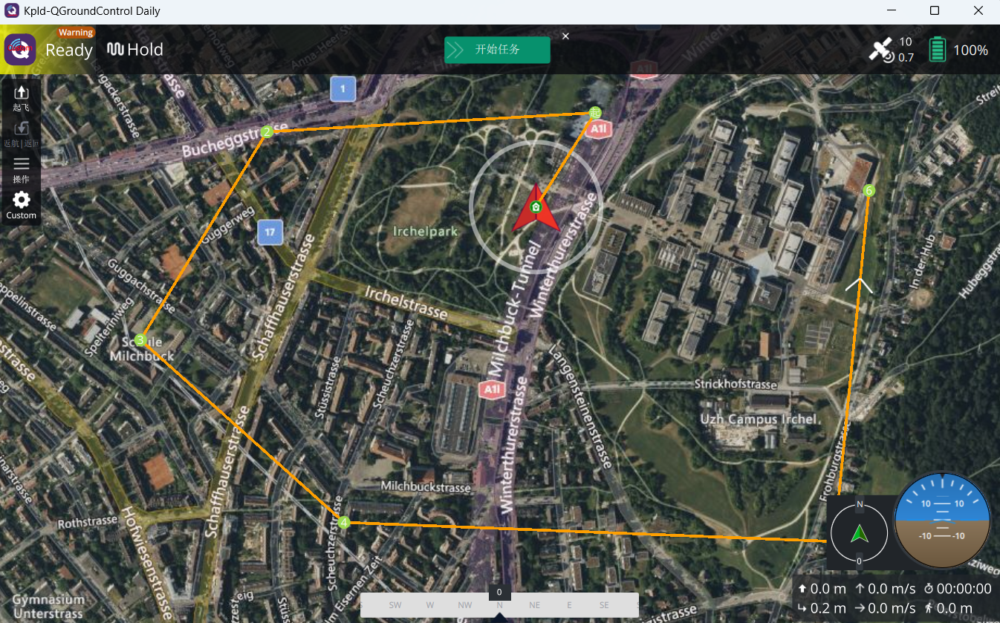
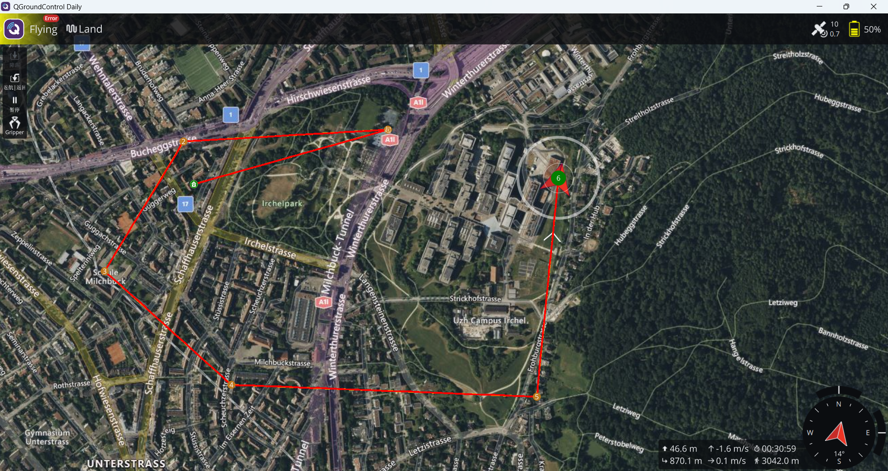

# Kpld-QGroundControl — a QGroundControl custom-build overlay

A personal customization layer for [QGroundControl](https://github.com/mavlink/qgroundcontrol) (master branch), built with upstream's `custom/` directory mechanism. It rebrands the application to **Kpld-QGroundControl** and documents a verified end-to-end run of the custom-build workflow: modify the overlay → build QGC from source → connect to a simulator → fly.



## What the overlay does

- Starts from upstream's `custom-example`: a commercial-style variant with most vehicle settings hidden (full experience remains available in Advanced Mode), custom branding, and a custom flight-instrument widget replacing the standard one.
- Renames the application in `custom/cmake/CustomOverrides.cmake`:

  ```cmake
  set(QGC_APP_NAME "Kpld-QGroundControl" CACHE STRING "App Name" FORCE)
  ```

  The running app's title becomes "Kpld-QGroundControl Daily". **The value must be changed in this file** — `CustomOverrides.cmake` force-overwrites the CMake cache on every configure, so editing the app name in an IDE's build settings is silently undone.
- Nothing in mainline QGC is modified. All customization lives in `custom/`, which keeps merging upstream master cheap — the arrangement upstream recommends.

## Build

QGroundControl master pins exactly one Qt version per revision; this build uses **Qt 6.12.0** with **MSVC 2022 64-bit** (Qt Creator, Release configuration).

1. Clone QGroundControl master.
2. Copy this repository's `custom/` directory into the QGC source root. Copy `custom-example` — do not rename it — so upstream merges stay painless.
3. Open the top-level QGC `CMakeLists.txt` (the overlay's own `CMakeLists.txt` is a fragment, not a standalone project), create a **new, clean build directory**, and set the CMake variable `QGC_CUSTOM_DIR=custom`. (On master the example directory is spelled with a hyphen: `custom-example`.)
4. Configure, build, run.

Upstream documentation: [Custom builds — fork repo method](https://docs.qgroundcontrol.com/master/en/qgc-dev-guide/custom_build/fork_repo.html)

Troubleshooting, both hit and solved during this build:

- If the built app fails to start with missing QtQuick/QML module errors, add the Qt QML directory to `QML2_IMPORT_PATH` (e.g. `<Qt>\6.12.0\msvc2022_64\qml`).
- If Qt Creator adds an *Install Application Manager package* deploy step to a fresh build configuration, delete that step — it targets embedded app-manager installs and does not exist on a desktop setup. The executable itself is already built under the build directory's `Release/` folder.

## Verified against PX4 SITL

- **Simulator:** PX4 v1.17.0, built-in SIH quadcopter — `make px4_sitl sihsim_quadx` — running in a virtual machine.
- **Link:** QGC-initiated UDP, local port **14550**, target `<sitl-host-ip>:18570`. Custom builds keep their own settings, separate from a stock QGC install, so the comm link is created once inside the custom build.
- **Custom build check:** Kpld-QGroundControl connected to the simulator with GPS 10 satellites, battery 100%, vehicle Ready/Hold, and the five-waypoint mission route loaded on the map.
- **Flight verification** (source-built QGC master, same SITL setup): guided flight 423 m out and back in 3 min 51 s; a five-waypoint mission of ~3,042 m completed with automatic landing — no simulator sensor dropouts in either flight (23 Nov 2026).
- **Known quirk:** after a SITL restart, QGC can stay stuck on "Comms Lost" even though the vehicle is up and has logged the ground station. An in-app disconnect/reconnect does not recover it — fully exit and reopen QGC on every SITL restart.



*The five-waypoint mission in flight (source-built QGC master, same PX4 SIH setup): the status readout at bottom-right shows the 3,042.0 m total distance.*

All flight testing for this project is simulation-only (PX4 SITL/SIH). No real aircraft is flown or used.

## Repository layout

- `custom/` — the overlay itself: upstream `custom-example` plus the branding change described above.
- `docs/images/` — screenshots, including the five-waypoint mission shown at the top.

## License

QGroundControl is dual-licensed under the Apache License 2.0 and GPLv3. This overlay is a personal project built on upstream's custom-build mechanism; see the upstream project for the full license terms.
